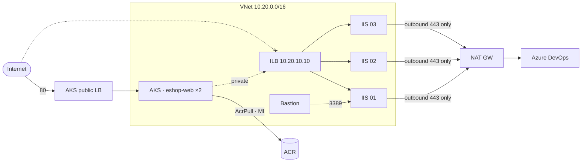

# platform-infra – hybrid .NET platform on Azure

Terraform and documentation for a platform that runs two versions of the same
"eShop" business side by side:

| | App | Runtime | Where | Reachable from |
|---|---|---|---|---|
| **A** | [eShopOnWeb fork](https://github.com/bilalmushtaq514/eShopOnWeb) | ASP.NET Core **.NET 10** (LTS) | AKS (Linux containers) | Internet: `http://eshop-hybrid-dev.eastus2.cloudapp.azure.com` |
| **B** | [eShopModernizing fork → eShopLegacyMVC](https://github.com/bilalmushtaq514/eShopModernizing) | ASP.NET MVC 5 on **.NET Framework 4.7.2** | 3 × Windows Server 2022 / IIS, private subnet, internal LB | Inside the VNet only: `http://10.20.10.10` |

Everything is built with **Terraform** and delivered by **Azure DevOps** YAML
pipelines connected to GitHub (`dev.azure.com/bilalmushtaq514/hybrid-platform`).



## Deliverables at a glance

| # | Deliverable | Where |
|---|---|---|
| 1 | Three repos | [platform-infra](https://github.com/bilalmushtaq514/platform-infra) · [eShopOnWeb fork](https://github.com/bilalmushtaq514/eShopOnWeb) · [eShopModernizing fork](https://github.com/bilalmushtaq514/eShopModernizing) |
| 2 | Azure DevOps project | `https://dev.azure.com/bilalmushtaq514/hybrid-platform` – pipelines *A - eShopOnWeb to AKS*, *B - eShopLegacyMVC to private IIS*, *platform-infra (Terraform)*; environments `aks-dev`, `iis-dev` (3 VMs + approval), `infra-dev` (approval) |
| 3 | Evidence for §3.3 | [docs/evidence/verification.md](docs/evidence/verification.md): public app, private IIS (failed request + no public IPs), in-VNet LB rotation, v2 change on both, broken deployments caught, rollback |
| 4 | `terraform plan` / `state list` | [terraform-plan-initial.txt](docs/evidence/terraform-plan-initial.txt) · [terraform-plan-drift-check.txt](docs/evidence/terraform-plan-drift-check.txt) · [terraform-state-list.txt](docs/evidence/terraform-state-list.txt) |
| Live | Modern app | http://eshop-hybrid-dev.eastus2.cloudapp.azure.com (while the environment is running) |

## Documentation

| Doc | Contents |
|---|---|
| [docs/architecture.md](docs/architecture.md) | Full diagram, components, why this shape |
| [docs/network.md](docs/network.md) | CIDRs, subnets, NSG rules with reasoning, traffic flows |
| [docs/terraform.md](docs/terraform.md) | Structure, conventions, remote state and locking, how to run |
| [docs/pipelines.md](docs/pipelines.md) | Both app pipelines stage by stage, **how the pipeline reaches the private servers**, end-to-end flows |
| [docs/security.md](docs/security.md) | Configuration and secrets per component, security decisions, trade-offs and risks (incl. the legacy stack) |
| [docs/operations.md](docs/operations.md) | Rollback, node failure mid-deploy, verification commands, teardown, cost, improvements |
| [docs/repo-selection.md](docs/repo-selection.md) | Which repos, why, legacy build issues hit and how they were solved |
| [docs/evidence/](docs/evidence/) | `terraform plan`, `terraform state list`, verification output, pipeline runs |

## Repository map

```
bootstrap/        one-off: state storage (Entra-only, versioned) + platform Key Vault
envs/dev/         environment root (remote state) - composes the modules
modules/          network · aks · iis-tier · bastion
scripts/          Azure DevOps wiring: OIDC service connections, environments + approvals, variable groups
pipelines/        shared Terraform pipeline steps
azure-pipelines.yml   validate → plan → (approval) → apply
```

## Requirement traceability

| Req | Where |
|---|---|
| I-1 RG, VNet, subnets AKS/IIS/Bastion | `modules/network`, `envs/dev/main.tf` |
| I-2 AKS + ACR, MI pull, no admin user | `modules/aks` (`admin_enabled=false`, `AcrPull` → kubelet identity) |
| I-3 3 × Windows 2022 + IIS + ASP.NET 4.x, private subnet | `modules/iis-tier` |
| I-4 No public IP; NSG denies Internet; only VNet/Bastion to 80/443/3389 | `modules/network` NSG rules, NICs without public IP |
| I-5 Internal LB + health probe | `modules/iis-tier` (`lbi-…`, probe `/health`) |
| I-6 IIS features, site, CLR v4.0 pool automated | `modules/iis-tier/scripts/iis-bootstrap.ps1` via Run Command |
| I-7 Remote state with locking | `bootstrap/`, `envs/dev/versions.tf` (blob lease) |
| I-8 Modules, variables, outputs, naming, tags, fmt/validate | all; CI `Validate` stage |
| I-9 No secrets in Git | Key Vault (PAT, VM password), OIDC, `.gitignore` |
| I-10 Outbound-only egress via NAT | `modules/network` NAT GW + `default_outbound_access_enabled=false` |
| I-11 Own repo | this repo |
| A-1…A-6, B-1…B-7, P-1…P-3 | [docs/pipelines.md](docs/pipelines.md) |

## Quick start

See [docs/terraform.md](docs/terraform.md#how-to-run). In short: `bootstrap` → `scripts/setup-azdo-*.sh` → put the PAT in Key Vault → `envs/dev` apply.
Teardown: [docs/operations.md](docs/operations.md#teardown).
