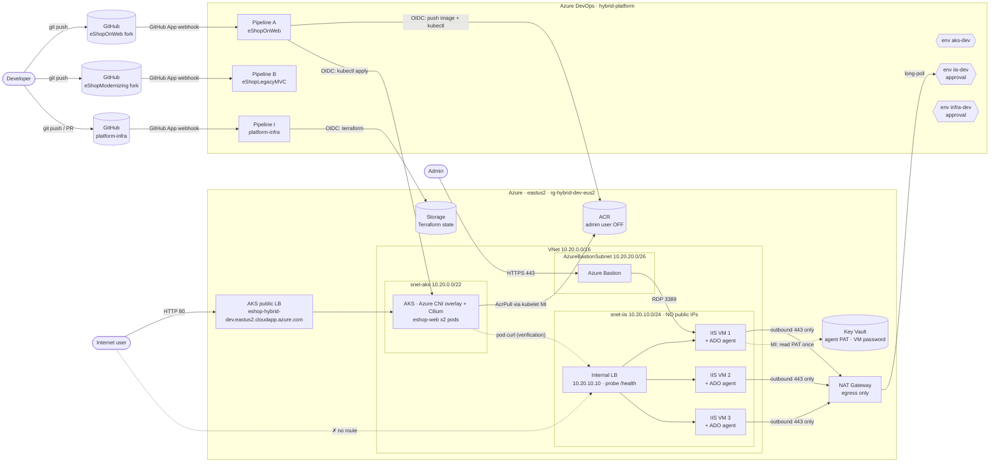

# Architecture

## Diagram

## The two apps

| | Modern (A) | Legacy (B) |
|---|---|---|
| App | `eShopOnWeb` Web (ASP.NET Core MVC + Razor + Blazor admin) | `eShopLegacyMVC` (ASP.NET MVC 5) |
| Runtime | .NET 10 (LTS) in a Linux container | .NET Framework 4.7.2 on Windows Server 2022 / IIS 10 (CLR v4.0 pool) |
| Data | EF Core in-memory provider (`UseOnlyInMemoryDatabase=true`) | `UseMockData=true` (in-memory `CatalogServiceMock`) |
| Hosting | AKS Deployment, 2 replicas, `Service type=LoadBalancer` | 3 VMs across zones 1/2/3 behind a Standard **internal** LB |
| Exposure | Public: `http://eshop-hybrid-dev.eastus2.cloudapp.azure.com` | Private only: `http://10.20.10.10` (VNet) |
| Deploy mechanism | Hosted agent → ACR push → `kubectl apply -k` | Agent **on each VM** pulls the job (outbound) → rolling switch |

## Why this shape

* **One VNet, three purpose-built subnets.** AKS, IIS and Bastion have different
  trust levels, so each has its own subnet and NSG. A single VNet keeps the
  "AKS pod calls legacy app over the private network" path trivial (no peering).
* **Private legacy tier.** No public IPs on the VMs, an *internal* LB, an NSG
  that explicitly denies the Internet tag, and a subnet with *default outbound
  access disabled* so the only way out is the NAT Gateway.
* **Pull-based deployment to private servers.** Instead of opening WinRM/SMB/RDP
  to a build agent, each IIS VM runs the Azure Pipelines agent registered in an
  *Environment*. The agent only makes outbound HTTPS calls to `dev.azure.com`.
  This is what makes "deploy to servers with zero inbound exposure" possible.
* **Identity everywhere, secrets nowhere.**
  * Pipelines → Azure: workload identity federation (OIDC), no client secret.
  * AKS → ACR: kubelet managed identity with `AcrPull`, ACR admin user disabled.
  * Humans/pipelines → AKS: Entra ID + Azure RBAC, Kubernetes local accounts disabled.
  * IIS VMs → Key Vault: system-assigned identity with `Key Vault Secrets User` on
    **one secret** (the agent PAT), not the whole vault.
  * Terraform → state: Entra ID (`use_azuread_auth`), storage keys disabled.
